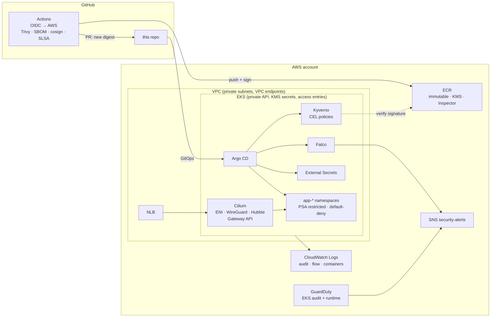

# tf-eks-infra

A secure Kubernetes reference platform on **AWS EKS**, built with **Terraform** and handed off to **Argo CD**. It's organized around five security pillars, and each one is enforced in code rather than just described:

| Pillar | Enforced by |
|---|---|
| **Workload identity** | EKS Pod Identity, one IAM role per ServiceAccount; no static keys; IMDSv2 hop limit 1; no SA token automount |
| **Supply chain & image hardening** | Private ECR (immutable tags, KMS, continuous Inspector scans); CI with GitHub OIDC; Trivy gate; SBOM; keyless cosign signatures; SLSA provenance; Kyverno admits only signed, digest-pinned images from our registry |
| **Workload isolation** | Pod Security Admission `restricted` on every tenant namespace; Kyverno CEL policies for read-only root FS, resource limits, dedicated ServiceAccounts, and no host namespaces; Bottlerocket nodes; Argo CD AppProjects that fence teams in |
| **Network segmentation** | Private subnets, no node public IPs, VPC endpoints, flow logs; restricted API endpoint; Cilium (eBPF, kube-proxy replacement) with WireGuard; auto-generated default-deny NetworkPolicies; one shared Gateway as the only way in |
| **Runtime detection & logging** | EKS control-plane + audit logs (KMS, 365 days); GuardDuty EKS audit + Runtime Monitoring; Falco (modern eBPF) → Falcosidekick; both alert to one SNS topic; Hubble flow metrics; container logs via CloudWatch Observability |

See **[docs/security-controls.md](docs/security-controls.md)** for the full control-by-control mapping to CIS EKS, the NSA/CISA hardening guide and NIST SP 800-190.

## Architecture



**Split of responsibility:** Terraform owns everything that touches the cloud API: the network, the cluster, IAM, KMS, the registry, GuardDuty, and the CNI (since nothing runs without one). It then installs Argo CD and a single root Application. Everything inside the cluster after that comes from Git (`platform/`, `policies/`, `workloads/`).

## Repository layout

```
terraform/
  bootstrap/                  one-time: KMS-encrypted state bucket, GitHub OIDC, CI roles
  modules/
    aws/network               VPC, private/public/intra subnets, NAT, endpoints, flow logs
    aws/eks                   EKS control plane + Bottlerocket node groups (hardened)
    aws/eks-cni               Gateway API CRDs → Cilium → CoreDNS
    aws/workload-identity     identities map → EKS Pod Identity roles
    aws/registry              ECR + CI push role
    aws/detection             GuardDuty, alert routing, container logs
    platform-bootstrap        cloud-neutral: Argo CD + AppProjects + root app
  envs/dev                    composes the modules
platform/
  bootstrap/                  root Helm chart: one Application per component, cloud-aware
  values/<component>/         common.yaml + eks.yaml (+ gke.yaml later)
policies/kyverno/             CEL admission policies (Helm chart)
workloads/sample/             hardened example app (base + overlays/eks)
app/sample/                   its Go source + distroless Dockerfile
.github/workflows/            terraform, image (supply chain), manifests
docs/                         controls mapping, getting started, GKE guide, decisions
```

## Getting started

First-time AWS deployment, command by command: **[docs/TF-init-deployment.md](docs/TF-init-deployment.md)**. After the cluster is up (GitOps, CI, sample app): **[docs/getting-started.md](docs/getting-started.md)**. In short:

```bash
# 1. One-time foundation (local state, then migrate it into the bucket it creates)
terraform -chdir=terraform/bootstrap init && terraform -chdir=terraform/bootstrap apply

# 2. Fill terraform/envs/dev/backend.tf and terraform.tfvars (see .example)
terraform -chdir=terraform/envs/dev init
terraform -chdir=terraform/envs/dev apply -target=module.network -target=module.eks   # first run only
terraform -chdir=terraform/envs/dev apply

# 3. Watch Argo CD bring the platform up
$(terraform -chdir=terraform/envs/dev output -raw kubeconfig_command)
kubectl -n argocd get applications
```

## Local checks

```bash
make check        # terraform validate + tflint + trivy + checkov + rendered-manifest validation
```

## Status

This is a **reference skeleton**. It validates and renders cleanly, but it hasn't been applied to a live account yet. Known gaps and next steps are tracked in [docs/security-controls.md#known-gaps](docs/security-controls.md#known-gaps). The design is built to [add GKE](docs/adding-gke.md) without restructuring.

## License

MIT
