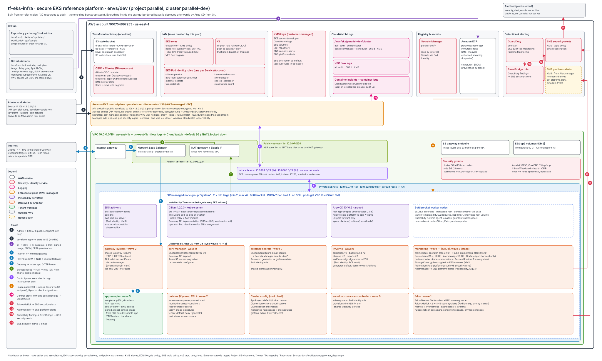

# Architecture diagram

The `envs/dev` deployment: every resource in the Terraform plan (130 to add) plus the bootstrap stack, and the components Argo CD deploys afterwards.

| File | Open with |
|---|---|
| `tf-eks-infra-architecture.svg` | Any browser, or embed in Markdown |
| `tf-eks-infra-architecture.drawio` | diagrams.net / draw.io (desktop, web or VS Code extension). Editable |
| `tf-eks-infra-architecture.vsdx` | Microsoft Visio, or draw.io / LibreOffice Draw. Editable |

All three come from one model in `generate_diagram.py`. Edit the `NODES` / `EDGES` lists there and regenerate rather than editing one file by hand, so the formats stay in sync:

```bash
python3 docs/architecture/generate_diagram.py
```


